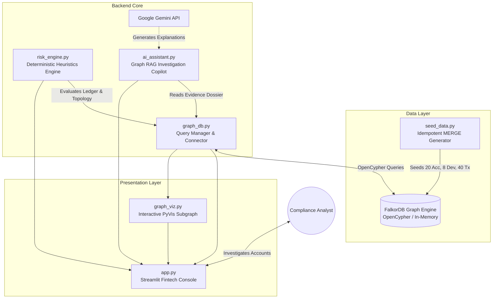
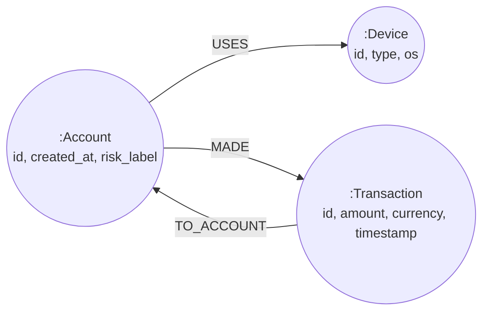
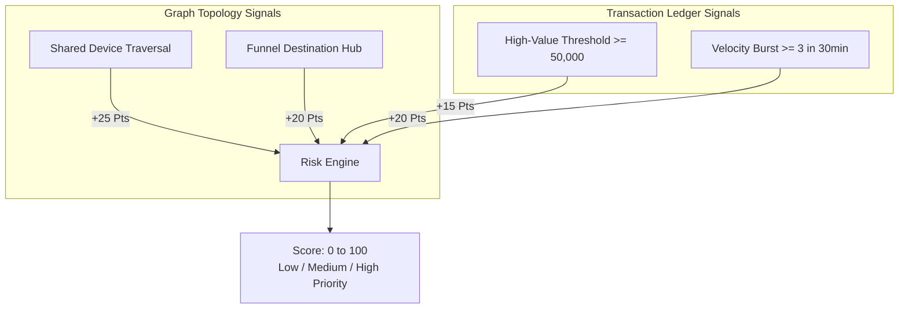

# 🔍 FraudLens: Graph-Powered Financial Crime & Mule Ring Investigation Console

> **FalkorDB Graph Hacks 2025**  
> **Track:** Financial Fraud Detection & AI Agents / Graph RAG  
> An explainable, real-time investigation console for tracking financial fraud, money muling rings, and device-sharing syndicates using **FalkorDB** and graph-grounded AI copilot analysis.

---

## 📌 Executive Summary

**FraudLens** is an interactive fraud forensics console built on **FalkorDB** that enables financial intelligence analysts to detect, trace, and explain complex financial crime patterns. Unlike relational databases that choke on multi-hop recursive queries, FraudLens uses high-performance OpenCypher graph traversals to uncover circular money laundering rings, shared device hardware farms, and velocity bursts. Every finding is scored with transparent, deterministic heuristics and accompanied by verifiable node and transaction evidence IDs—supported by an optional AI investigation assistant that synthesizes graph dossiers without hallucinations.

---

## 🎯 The Problem Being Solved

Organized financial crime and money muling syndicates exploit the blind spots of relational databases:
1. **Relational Table Silos:** Identifying money moving across $N$ hops (`A → B → C → D → A`) requires expensive, high-latency SQL `JOIN` cascades that degrade real-time performance.
2. **Hidden Hardware Footprints:** Fraud syndicates frequently operate dozens of synthetic bank accounts from a single batch of emulator devices or rooted mobile phones. Relational lookups often isolate accounts and miss device cluster hubs.
3. **Black-Box AI Decisions:** Machine learning fraud models often output opaque probabilities without actionable trails. Investigators require transparent, rule-backed evidence IDs to substantiate regulatory filings (e.g., Suspicious Activity Reports).

---

## 🌟 Features Implemented & Incomplete Features

### ✅ Implemented Features
* **Real-Time FalkorDB Graph Analytics:** Direct OpenCypher integration with live cloud or containerized FalkorDB instances.
* **Deterministic Risk Engine:** Transparent, rule-based scoring function (0–100) that categorizes risk into **Low**, **Medium**, and **High** priority with full evidence ID auditing.
* **Idempotent Synthetic Data Generator:** Deterministic synthetic dataset generator (`seed_data.py`, seed=42) creating 20 accounts, 8 hardware devices, 40 transactions, and a deliberate 4-hop circular muling ring using Cypher `MERGE`.
* **Interactive Network Graph Visualizer:** Embedded PyVis/Vis.js interactive topology canvas showing 1-hop and 2-hop neighborhoods with distinct node icons, colors, and labeled relationships (`USES`, `MADE`, `TO_ACCOUNT`).
* **Graph-Grounded AI Investigation Assistant:** Gemini-powered analyst copilot with strict prompt grounding and a verified deterministic fallback if an API key is omitted or rate-limited.
* **Mission-Critical Enterprise UI:** Styled with a dark-navy fintech palette, 4 overview metrics, account risk breakdown panels, transaction ledgers, and shared-device hubs.
* **Graceful Degradation:** Resilient error boundaries that handle database disconnections and missing accounts without crashing the app.
* **Automated 15-Point QA Suite:** End-to-end regression and verification test suite ([qa_e2e_test.py](qa_e2e_test.py)).

### ⏳ Incomplete Features & Roadmap (Not in Current Scope)
* **Real-Time Streaming Ingestion:** Currently, data is ingested via batch seed scripts; real-time Kafka or RabbitMQ event streaming is planned.
* **Native Graph Algorithms:** Centrality and Louvain community detection algorithms via FalkorDB extensions.
* **Role-Based Access Control (RBAC):** Multi-tenant authentication and case management sign-offs.
* **PDF SAR Report Export:** One-click automated export of investigation dossiers for compliance teams.

---

## 🏗️ System Architecture



---

## 💻 Technology Stack

* **Graph Database:** [FalkorDB](https://www.falkordb.com/) (OpenCypher graph engine running on Redis protocol)
* **Python SDK:** `falkordb-py` (v1.8.0), `redis` (v5.2.1)
* **Application Framework:** Streamlit (v1.40.0+)
* **Graph Visualization:** PyVis (v0.3.2) & Vis.js (HTML5 Canvas)
* **Data Processing:** Pandas (v2.2.0+)
* **AI & LLM Grounding:** Google GenAI SDK (`google-genai` / `google-generativeai`)
* **Environment & Config:** `python-dotenv`

---

## 📐 FalkorDB Graph Schema

The FraudLens graph data model captures money movements and entity-hardware associations:



### Node Labels and Properties

| Node Label | Property | Type | Description |
|---|---|---|---|
| `:Account` | `id` | String | Unique synthetic identifier (e.g., `A101`–`A120`) |
| `:Account` | `created_at` | String | ISO 8601 creation timestamp |
| `:Account` | `risk_label` | String | Initial baseline label (`Normal`, `Suspicious`) |
| `:Device` | `id` | String | Hardware identifier (e.g., `D01`–`D08`) |
| `:Device` | `type` | String | Device category (`mobile`, `desktop`, `tablet`) |
| `:Device` | `os` | String | Operating system (`Android`, `iOS`, `Windows`, `macOS`) |
| `:Transaction` | `id` | String | Transaction identifier (e.g., `T1001`–`T1040`) |
| `:Transaction` | `amount` | Float | Transfer value (INR currency) |
| `:Transaction` | `currency` | String | Synthetic currency denomination (`INR`) |
| `:Transaction` | `timestamp` | String | ISO 8601 transaction execution timestamp |

### Relationship Types

| Relationship | Direction | Description |
|---|---|---|
| `:USES` | `(:Account)-[:USES]->(:Device)` | Associates a bank account with a physical hardware device. |
| `:MADE` | `(:Account)-[:MADE]->(:Transaction)` | Originating sender of a transfer. |
| `:TO_ACCOUNT` | `(:Transaction)-[:TO_ACCOUNT]->(:Account)` | Destination recipient of a transfer. |

---

## ⚡ Important Cypher Queries

All core queries reside in [queries.cypher](queries.cypher) and [graph_db.py](graph_db.py):

### 1. Overview Graph Totals
```cypher
MATCH (a:Account) WITH count(a) AS total_accounts
MATCH (d:Device) WITH total_accounts, count(d) AS total_devices
MATCH (t:Transaction) WITH total_accounts, total_devices, count(t) AS total_transactions
MATCH (f:Account {risk_label: 'Suspicious'}) WITH total_accounts, total_devices, total_transactions, count(f) AS flagged_accounts
RETURN total_accounts, total_devices, total_transactions, flagged_accounts;
```
*Purpose:* Computes executive dashboard counts without full client-side fetches.

### 2. Multi-Account Device Sharing Detection
```cypher
MATCH (a:Account {id: $account_id})-[:USES]->(d:Device)<-[:USES]-(other:Account)
WHERE a.id <> other.id
RETURN d.id AS device_id, d.type AS device_type, other.id AS shared_with_account_id;
```
*Purpose:* Traverses from an account through hardware devices to uncover co-operating syndicate accounts.

### 3. Circular Money Laundering Detection (2 to 5 Hops)
```cypher
MATCH path = (start:Account {id: $account_id})-[:MADE]->(:Transaction)-[:TO_ACCOUNT]->
             (b:Account)-[:MADE]->(:Transaction)-[:TO_ACCOUNT]->
             (c:Account)-[:MADE]->(:Transaction)-[:TO_ACCOUNT]->(start)
RETURN [n in nodes(path) WHERE n:Account | n.id] AS cycle_accounts;
```
*Purpose:* Traverses cyclic payment paths where money loops back to the originator.

### 4. Account Ego-Neighborhood Subgraph (for Network Visualizer)
```cypher
MATCH (a:Account {id: $account_id})-[r:USES|MADE]-(connected)
OPTIONAL MATCH (connected)-[r2:TO_ACCOUNT|USES]-(second_hop)
RETURN a, r, connected, r2, second_hop;
```
*Purpose:* Dynamically fetches 1-hop and 2-hop graph entities to build the interactive HTML5 canvas.

---

## 🧮 How Graph Queries Drive Risk Scoring

Relational databases evaluate transactions in isolation against static rules (e.g., "is amount > 50,000?"). **FraudLens combines transactional data with graph topology.**



### Risk Scoring Rules Table

| Signal | Points | Condition | Graph / Ledger Source |
|---|---|---|---|
| **Shared Device** | **+25** | Account shares at least one physical device with $\ge 1$ other accounts. | `MATCH (a)-[:USES]->(d)<-[:USES]-(other)` |
| **Multi-Sender Destination** | **+20** | Destination account receives transfers from multiple distinct originators. | `MATCH (src)-[:MADE]->()-[:TO_ACCOUNT]->(dest)` |
| **High-Value Transfer** | **+15** | At least one transaction $\ge \text{₹}50,000$. | `Transaction.amount >= high_value_threshold` |
| **Velocity Burst** | **+20** | $\ge 3$ outbound transfers within a rolling 30-minute window. | Rolling timestamp window calculation on ledger |

* **Risk Labels:**
  * **Low:** `0 – 29` points
  * **Medium:** `30 – 69` points
  * **High:** `70 – 100` points (capped at 100)

### ⚠️ Heuristic Nature & Limitations
> **IMPORTANT:** The risk score generated by FraudLens is a **deterministic triage heuristic** designed to prioritize investigation workflows. It is **NOT** a calibrated statistical probability of fraud, nor does it constitute legal evidence or proof of guilt. Real-world fraud detection requires additional contextual dimensions (KYC history, geolocation anomalies, merchant MCC risk) and human investigator verification.

---

## 🛠️ Installation & Setup (Windows & Cross-Platform)

### 1. Prerequisites
* **Python 3.10+** (Tested on Python 3.14 on Windows 11)
* **Git**
* Active FalkorDB instance (FalkorDB Cloud or Docker)

### 2. Clone the Repository
```powershell
git clone https://github.com/GIT-GITteRR/fraudlens.git
cd fraudlens
```

### 3. Create and Activate Virtual Environment
On Windows (PowerShell):
```powershell
python -m venv .venv
.\.venv\Scripts\Activate.ps1
```
*(If PowerShell restricts scripts, run `Set-ExecutionPolicy -ExecutionPolicy RemoteSigned -Scope Process` first).*

On Linux / macOS:
```bash
python3 -m venv .venv
source .venv/bin/activate
```

### 4. Install Dependencies
```powershell
pip install -r requirements.txt
```

---

## ☁️ FalkorDB Setup Options

### Option A: FalkorDB Cloud (Recommended)
1. Sign up for a free cloud database instance at [app.falkordb.cloud](https://app.falkordb.cloud/).
2. Obtain your host URL, public port, and database password.
3. Add them to your `.env` file (see below).

### Option B: Local FalkorDB with Docker
If Docker Desktop is installed:
```powershell
docker run -p 6379:6379 -it --rm falkordb/falkordb:latest
```

---

## 🔑 Environment Variables Configuration

Create a `.env` file in the project root by copying [.env.example](.env.example):
```powershell
Copy-Item .env.example .env
```

Edit `.env` with your connection parameters:
```ini
# FalkorDB Connection Settings
FALKORDB_HOST=your-host.falkordb.cloud   # or 127.0.0.1 for local Docker
FALKORDB_PORT=49500                     # default 6379 for Docker
FALKORDB_PASSWORD=your_secure_password  # leave blank if local unauthenticated
FALKORDB_USERNAME=                      # leave blank for default
FALKORDB_GRAPH_NAME=fraudlens           # graph identifier

# Optional AI Investigation Assistant
GEMINI_API_KEY=your_gemini_api_key_here # optional; deterministic fallback is active if omitted
```

> **Security Check:** `.env` is permanently excluded from version control via `.gitignore`. Never commit API keys or database passwords.

---

## 📊 Initializing Synthetic Data

Seed the FalkorDB graph with the deterministic, reproducible dataset:
```powershell
python seed_data.py
```
*Output:*
```text
Connecting to FalkorDB at: r-6jissuruar.instance-b0t3freuf...
Upserting into demo graph 'fraudlens' without reset...
Generated 20 synthetic accounts.
Generated 8 synthetic devices.
Generated 40 synthetic transactions.
Idempotent seeding completed successfully.
```
*Note:* `seed_data.py` uses Cypher `MERGE`. Running it multiple times will update existing entities without duplicating graph nodes.

---

## 🚀 Running the Application

Launch the Streamlit console:
```powershell
streamlit run app.py
```
Open your browser at `http://localhost:8501`.

---

## 🧪 Testing & Verification

FraudLens includes unit tests and an automated 15-point end-to-end QA validation suite:

### 1. Test FalkorDB Connection
```powershell
python test_connection.py
```

### 2. Test Risk Engine Rules
```powershell
python test_risk_engine.py
```
*Verifies point calculations, velocity bursts, multi-sender detection, score capping, and empty state handling.*

### 3. Test AI Assistant & Fallback
```powershell
python test_ai_assistant.py
```
*Verifies evidence dossier generation, Gemini formatting, and deterministic offline fallback.*

### 4. Run the Full 15-Point QA Suite
```powershell
python qa_e2e_test.py
```
*Validates application health, connection pooling, seed idempotency, ledger matching, device mappings, and credential safety.*

---

## ⏱️ 90-Second Demo Walkthrough

1. **Step 1: Dashboard Overview (0:00–0:20)**
   * Launch `streamlit run app.py`. Notice the dark-navy fintech interface and the 4 metric cards (`20 Accounts`, `8 Devices`, `40 Transactions`, `3 Flagged Accounts`).
2. **Step 2: Inspecting a Normal Account (0:20–0:40)**
   * In the sidebar selector, choose **`A101`**.
   * Observe the risk badge: **Score 25 / 100 (LOW)**.
   * Review the ledger: ordinary single transactions, 1 private device (`D01`). No muling indicators.
3. **Step 3: Investigating the Muling Ring (0:40–1:15)**
   * Switch the selector to **`A115`**.
   * Observe the risk badge: **Score 40 / 100 (MEDIUM / HIGH PRIORITY)**.
   * View the **Risk Factors**: Multi-Sender Destination Hub detected, Velocity Burst triggered (4 transactions in rapid succession to `A116`).
   * Scroll to **Shared Hardware Devices**: Device **`D08`** is co-used by `A116`, `A117`, and `A118`.
   * Inspect the **Interactive Subgraph**: Zoom in on the PyVis canvas to visually confirm the circular money flow `A115 → A116 → A117 → A118 → A115` bound by device `D08`.
4. **Step 4: AI Copilot Audit (1:15–1:30)**
   * Enter a query into the AI Investigation Assistant: *"Why is account A115 prioritized for audit?"*
   * Click **Ask Assistant**. The copilot analyzes the graph dossier and cites exact transaction IDs (`T1001`–`T1004`) and shared hardware (`D08`) without hallucinating.

---

## 🚧 Known Limitations & Future Improvements

1. **Transaction Volumes:** Current demo dataset is tuned for ~100 entities to ensure instant interactive visualization rendering. Large-scale graphs (>1M nodes) require server-side sub-sampling before rendering in PyVis.
2. **Single-Tenant UI:** Built as an analyst workstation. Production deployment requires JWT-based authentication and audit logging.
3. **Dynamic Graph Algorithms:** Path traversals are currently rule-guided OpenCypher queries; future releases will integrate Louvain modularity clustering and PageRank algorithms directly inside FalkorDB.

---

## 🛡️ Synthetic Data & Responsible-Use Disclaimer

* **100% Synthetic Data:** All accounts (`A101`–`A120`), device IDs (`D01`–`D08`), and transaction IDs (`T1001`–`T1040`) are generated deterministically using pseudo-random seeds. Any resemblance to real persons, accounts, or bank identifiers is purely coincidental.
* **Intended Use:** FraudLens is an educational and analytical research demonstration built for graph hackathons and financial forensics education. It should not be used as an autonomous sanctioning or account-freezing engine without human analyst review and compliance verification.

---

## 🤖 AI Assistance Disclosure

In accordance with hackathon guidelines, the development of FraudLens utilized:
* **Google Antigravity IDE & Gemini Models:** Used for rapid prototyping, architecture brainstorming, Cypher syntax validation, and creating the end-to-end QA suite.
* **Google GenAI SDK (Gemini):** Integrated into [ai_assistant.py](ai_assistant.py) to provide evidence-grounded natural language investigation summaries. All prompts are strictly constrained to retrieved graph evidence dossiers.

---

## 🏆 Hackathon Submission Details

* **Hackathon:** FalkorDB Graph Hacks 2025
* **Selected Track:** Financial Fraud Detection & AI Agents / Graph RAG
* **Repository:** [https://github.com/GIT-GITteRR/fraudlens](https://github.com/GIT-GITteRR/fraudlens)
